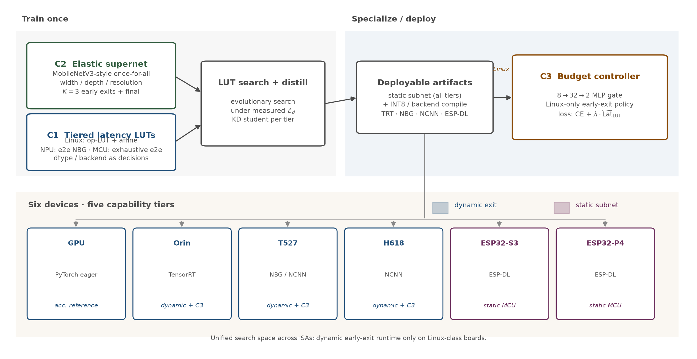

# DynEdge

[](LICENSE)
[](requirements.txt)
[](https://arxiv.org/)

**DynEdge: Latency-Aware Dynamic Inference for Heterogeneous Edge Devices: A Hardware-in-the-Loop Approach from GPU to Microcontroller**

Li Zhao (Heilongjiang Jiaotong Polytechnic),
Ming Zhao (Harbin Cambridge University),
Shu Wang (Heilongjiang Tianyouwei Technology Co., Ltd.; corresponding author)

> Status: submitted to **IEEE Internet of Things Journal** (Author Portal id `ce3dfb57`).  
> arXiv pre-print link: *placeholder — will be filled when posted*.

<p align="center">
  
</p>
<p align="center"><em>Figure 2 — Framework overview (tiered LUTs, elastic early-exit supernet, latency-budget controller).</em></p>

## Six-device matrix (paper deployment envelope)

| Tier | Device | Backend (paper) | Role |
|---|---|---|---|
| Edge GPU | Jetson Orin Nano 8GB | TensorRT FP16 / INT8 | High-end dynamic |
| SoC + NPU | Allwinner T527 | NCNN + VIPLite NBG | Mid / NPU |
| SoC CPU | H618 (OPi Zero3) | NCNN @4 threads | Low-end Linux |
| MCU (RISC-V) | ESP32-P4 | ESP-DL INT8 | Static Pareto anchor |
| MCU (Xtensa) | ESP32-S3 | ESP-DL INT8 | Static Pareto anchor |
| Server ref | CUDA GPU | PyTorch | Train / distill / search |

Measurement stack freeze: see [`dynedge/configs/versions.yaml`](dynedge/configs/versions.yaml) (Supplementary Table I).

## Quick Start (five steps)

```bash
# 0) clone + env
git clone https://github.com/T01284/dynedge.git
cd dynedge
python -m venv .venv && source .venv/bin/activate   # Windows: .venv\Scripts\activate
pip install -r requirements.txt
export PYTHONPATH=$PWD                              # so `import dynedge` resolves

# 1) data — download FERPlus / ExpW yourself (not redistributed)
#    follow dynedge/datasets/README.md → write caches under $DATA_ROOT
python -m dynedge.datasets.prepare_ferplus --help
python -m dynedge.datasets.prepare_expw --help

# 2) LUT — operator tables for Linux boards + MCU e2e truth (shipped under artifacts/luts/)
ls artifacts/luts/

# 3) search / distill (formal recipe in Supplementary Material)
#    evolutionary LUT arm vs FLOPs-control arm:
python -m dynedge.search.search_subnets_lut --help
python -m dynedge.search.search_subnets_flops_ctrl --help
python -m dynedge.train.train_subnet_distill --help
python -m dynedge.train.train_controller --help

# 4) deploy — pick a target; fill config.local.yaml from the example
cp dynedge/configs/config.example.yaml config.local.yaml
# edit BOARD_* placeholders, then:
#   H618/T527: dynedge/deploy/h618|t527 + shared dynedge/deploy/ncnn_edge
#   Orin:      dynedge/deploy/orin
#   ESP32:     dynedge/deploy/esp32  (S3 / P4 dual PlatformIO envs)

# 5) bench / energy
python -m dynedge.bench.p5s1.capture --help
python dynedge/bench/run_matrix.py --help
```

Seed-42 formal checkpoints and board binaries are **not** in git. Download from the
[GitHub Releases](https://github.com/T01284/dynedge/releases) page once assets are published
(see table below).

## Repository layout

```
dynedge/                 # installable-style package (PYTHONPATH=repo root)
  datasets/              # FERPlus / ExpW prep + MTCNN align (no images)
  models/                # elastic supernet, early-exit heads, slimmable BN, controller
  train/                 # supernet (sandwich+EMA), distill, train_controller.py
  lut/                   # gen_ops, operator mine helpers, MCU e2e enum / predict
  search/                # evolutionary search (LUT cost / FLOPs control)
  deploy/
    h618/  t527/  orin/  esp32/  ncnn_edge/
  bench/
    run_matrix.py        # dispatcher stub → per-board matrix entrypoints
    p5s1/                # P5S1 serial protocol + windowed energy integral
  configs/
    config.example.yaml  # board IP / serial / path template
    versions.yaml        # frozen toolchains
    labels.yaml          # class maps
artifacts/
  luts/                  # H618/T527 op LUTs + affine fidelity, MCU 34-row e2e table
  results/               # paper-table source CSVs
  subnet_configs/        # formal six anchors + FLOPs-control structure JSON
docs/
  figures/fig2_overview.png
  MEASUREMENT.md         # (stub) measurement protocol
  REPRODUCE.md           # (stub) table/figure command map
```

## Release assets (weights — not in git)

| Asset (planned) | Contents | Notes |
|---|---|---|
| `formal_seed42_ckpts.zip` | six FER+ anchors + ExpW twins (`.pt`) | seed 42; &lt;2 GB |
| `ncnn_h618_t527_baked.zip` | bake→pnnx `.param/.bin` | Linux SoCs |
| `t527_nbg_anchors.zip` | ACUITY→NBG | VIPLite |
| `orin_trt_engines.zip` | TensorRT engines | JetPack 6.2 |
| `espdl_s3_p4_images.zip` | ESP-DL flash images | S3 / P4 |

Until the first Release is cut, rebuild from your own distillates with the scripts under `dynedge/deploy/*/`.

## Citation

```bibtex
@article{zhao2026dynedge,
  title   = {{DynEdge}: Latency-Aware Dynamic Inference for Heterogeneous Edge Devices:
             A Hardware-in-the-Loop Approach from {GPU} to Microcontroller},
  author  = {Zhao, Li and Zhao, Ming and Wang, Shu},
  journal = {IEEE Internet of Things Journal},
  year    = {2026},
  note    = {Under review; Author Portal id ce3dfb57. Code: https://github.com/T01284/dynedge}
}
```

Also see [`CITATION.cff`](CITATION.cff) for GitHub’s “Cite this repository” button.

## What is intentionally absent

- Dataset **images** (FERPlus / ExpW licenses forbid redistribution) — only download/prep scripts.
- Board **IPs, passwords, serial device names** — placeholders in `config.example.yaml` only.
- Large **checkpoints / NCNN bins / NBG / ESP-DL images** — GitHub Releases, not git history.
- Internal lab ledger (`SUMMARY.md`) — distilled into this README / `docs/`.

## License

Apache License 2.0 — see [LICENSE](LICENSE).
